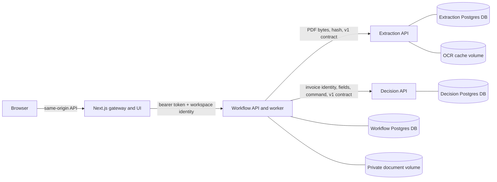

# InvoiceLens service architecture

InvoiceLens uses a small set of real services sized to the product’s resource and business boundaries. The browser talks to the Next.js gateway on the same origin. The gateway authenticates browser requests, enforces same-origin writes, applies request limits, and forwards them to the Workflow API. The Workflow worker calls Extraction for document interpretation and Decision for authoritative financial evaluations and review commands.

## Ownership and APIs

| Component                                  | Owns and may write                                                                                                                                         | Explicitly does not own                                                                                              |
| ------------------------------------------ | ---------------------------------------------------------------------------------------------------------------------------------------------------------- | -------------------------------------------------------------------------------------------------------------------- |
| Gateway (`src/app/api/[...path]/route.ts`) | Browser-facing routes, session/basic auth checks, same-origin mutation checks, rate limits, request limits, static synthetic sample downloads              | Invoice state, direct database access, decision policy, document persistence                                         |
| Workflow (`services/workflow`)             | Invoice metadata/state, private source PDFs, job queue and leases, stage events, correction and review history, correlations, retries, workflow API        | OCR internals, vendor/PO records, policy decisions, commitments                                                      |
| Extraction (`services/extraction`)         | PDF.js and Tesseract providers, provider version/provenance, hash-keyed cached extraction results, extraction idempotency records, private OCR temp files  | Browser identity, invoice lifecycle, vendor lookup, policy or approval decisions, database access for other services |
| Decision (`services/decision`)             | Vendors, purchase orders, business identity claims, invoice decision records, policy evaluations, idempotent decision commands, reservations and approvals | PDF files, OCR, invoice workflow state, user sessions or UI                                                          |

The Workflow API exposes `/v1/invoices`, `/v1/invoices/:id`, `/v1/invoices/:id/document`, `/v1/invoices/:id/events`, `/v1/invoices/:id/reviews`, and health routes. Extraction exposes `/v1/extractions`. Decision exposes `/v1/references`, `/v1/registrations`, `/v1/evaluations`, and `/v1/commands`. Request and response objects use Zod schemas in `packages/contracts`, carry an explicit `apiVersion`, and are validated at both service boundaries. Internal requests carry a correlation ID. The gateway holds a dedicated bearer token for Workflow; Workflow holds separate bearer tokens for Decision and Extraction. Production service endpoints are private to the Compose network.

Each service owns a `DATABASE_URL` and SQL migration sequence. Workflow, Extraction, and Decision have separate login roles and databases. No service reads another service’s schema. `scripts/migrate-legacy.ts` is the only cross-database write tool and runs as an explicit, one-time migration utility with a read-only source snapshot.

## Persistence and failure recovery

Workflow uploads write a generated private file key and then atomically create invoice metadata, a durable job, and the first event. Jobs use `FOR UPDATE SKIP LOCKED`, generation numbers, a random lease token, a renewing lease, and retry recovery. A worker write checks the invoice generation and active lease before updating state or recording a stage. A process crash allows the expired lease to be requeued; repeated interruptions are bounded. Existing extraction evidence is retained in workflow state so review corrections do not need to parse the same PDF again.

Extraction verifies the content digest against the received PDF, uses a lease for cache work, stores a versioned result, and fences stale writers by lease token. It writes private temporary files and enforces page and byte limits. The request does not contain an arbitrary URL, so the service cannot fetch an attacker-controlled remote document. The workflow has a finite timeout when calling downstream services.

Decision is the only writer for financial state. It serializes evaluation and command transactions, checks the exact PDF hash and normalized vendor/invoice identity, evaluates against current references, and reserves PO capacity within the same transaction as the decision snapshot. Reservations and approved commitments both count against the PO’s hard limit. An approval command requires an unchanged recommendation and an existing reservation. Commands require an idempotency key with a request fingerprint; a repeated key with a different action is rejected. Rejection releases the reservation. The worker’s review endpoint returns `202` after storing a durable command job; the browser reports that recording is pending and polls persisted state.

Health separates liveness from readiness. Readiness checks the service’s own database; Workflow also checks worker heartbeat and downstream APIs. Logs include service, event, and correlation IDs. They avoid PDF bytes, extracted text, credentials, and request bodies.

Review requests now record the available actor, reason, revision, generation, correlation ID and correction/PO before-and-after values with the queued job and event in one Workflow transaction. The current shared/local credential cannot identify a person; historical shared actors are labeled accordingly. Completed review state, its job and completion event now commit together. A failed review job can be retried with its original Decision idempotency key; no reservation is released merely on timeout. A restart test covers a Decision approval committed before its response is received, but there is no general cross-service reconciliation service yet.

OCR-derived invoices require explicit verification of extracted values against the original before approval. The Decision evaluation remains deterministic; this guard does not establish extraction accuracy or validate complex layouts.

## Migration and recovery

The previous single-database app is not reused as a service database. `npm run migrate:legacy -- --source-env=.env` (or `--source=...`) begins a repeatable-read, read-only transaction and reports source counts. Adding `--apply` copies vendors, purchase orders, invoice decision snapshots, commitments, invoice metadata, events, and original PDFs into the isolated service databases. Before either dry-run completion or apply, the script verifies every PDF's safe key, signature, and digest. It records per-service import markers and uses conflict-safe inserts, so a retry does not duplicate invoices or audit events. Queued and running work is requeued with a new lease. The source receives no schema changes, updates, deletes, or resets.

Before migration, take the normal DB and file backups. After migration, compare invoice counts and representative state, open stored PDFs, compare vendor/PO balances and commitments, then keep the old data intact until the new service is accepted. Run a recovery test against a disposable copy before using this path for a production data set. This local repository copied five synthetic demo invoices, four vendors, five purchase orders, two commitments, and 70 events; it has not migrated any live or personal database.

The Compose file uses one PostgreSQL server process for operational simplicity but creates three databases and three least-privilege service roles. If a database server outage occurs, Workflow retains queued job state, readiness fails, and jobs resume after the database recovers. If Decision or Extraction is unreachable, Workflow retries through the durable job path. OCR is cached by content hash; it is safe to retry extraction. Images use non-root Node users, and documents/OCR cache live on separate named volumes.

## Runtime limits and next operational steps

This topology is intended for a single workspace and modest assessment/demo load. For a hosted production rollout, add a managed secret store, OIDC and role based access, external rate limiting, database backups and restore drills, retention/deletion policy, malware scanning, alerting, externally retained immutable audit records, migration rehearsal against a cloned dataset, and measured concurrency before increasing worker counts. Multi-tenant controls and business locks should be narrowed from the current conservative Decision transaction lock before high concurrency. InvoiceLens records decisions and reservations; it is not a payment integration.
