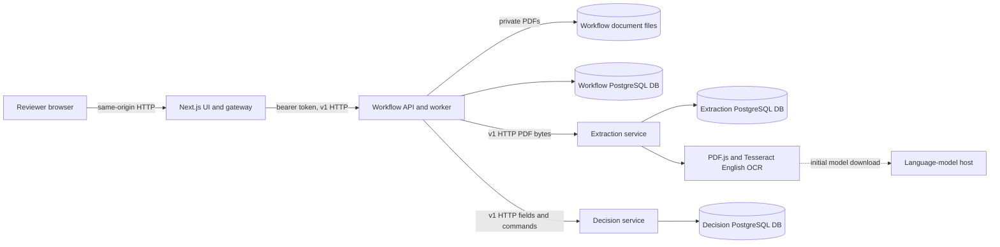

# InvoiceLens production-readiness audit

Audit date: 31 October 2026. Repository: `/Users/mohitsagar/Desktop/code/zamp`; base commit `679389fa11e0435e0c773527b2a7b827e421baeb`. The audited application is the **uncommitted working tree**, not that commit alone: it includes modified frontend, configuration, tests and documentation, deleted legacy monolith files, and untracked `services/`, `packages/`, and migration scripts. `git status --short` was recorded at the beginning; existing changes were preserved. This report is the only intended repository change in this audit. No existing database, user documents or external systems were modified.

## 1. Executive verdict

Assumptions: one trusted workspace, low volume, one organization, sensitive invoices and PO data, a human reviewer, and an operator responsible for a privately hosted system. No availability or recovery objective has been specified. Public deployment means internet-accessible, potentially multiple users or organizations, and adversarial traffic.

| Environment                            | Verdict                 | Basis                                                                                                                                                                                                                                                         |
| -------------------------------------- | ----------------------- | ------------------------------------------------------------------------------------------------------------------------------------------------------------------------------------------------------------------------------------------------------------- |
| Local development                      | **CONDITIONALLY READY** | Isolated installs, migrations, builds and the exercised stack work. Service-only builds need an undocumented root dependency resolution workaround; the exact documented persistent local setup was not rerun because its fixed port is already occupied.     |
| Assessment/demo                        | **CONDITIONALLY READY** | Synthetic examples, real PDF.js extraction, Tesseract OCR, decision rules and browser workflows passed the isolated suite. The correction-reason audit gap and misleading stage/readiness details should be disclosed.                                        |
| Internal pilot with real business data | **NOT READY**           | No individual accountability, supported reference-data provisioning, demonstrated backup/restore or retention; correction reasons are missing from the visible audit; distributed failure recovery and real-document accuracy are insufficiently established. |
| Public production                      | **NOT READY**           | Identity, authorization, tenant isolation, TLS infrastructure, abuse controls, operations, deployment and security validation are inadequate or absent. Compose has not been run.                                                                             |

This is a real processing application, not a set of hardcoded decisions. It is a small distributed service system with distinct storage ownership, but it is not established as production-ready. The finite synthetic tests do not establish correctness for arbitrary invoices, real accounting policies, adversarial files, or all failure interleavings.

## 2. System map

The browser polls the gateway every 1.5 seconds; this implementation does **not** use SSE (`src/components/workspace.tsx:73`, `:111`). Workflow stores documents and state, Extraction caches full extracted text and fields, and Decision owns references, claims, decisions and commitments (`services/workflow/migrations/001.sql:1`, `services/extraction/migrations/001.sql:1`, `services/decision/migrations/001.sql:1`). There are three logical databases and credentials on a single Compose PostgreSQL instance (`compose.yaml:1`, `scripts/postgres-init.sh`). The services use common source contracts (`packages/contracts/src/index.ts:1`); an explicit cross-database migration utility is a one-off exception (`scripts/migrate-legacy.ts:150`, `:238`). No LLM or paid provider is implemented in the inspected processing path. OCR uses a real local engine; its language model may require a network download (`services/extraction/src/provider.ts:121`).

Service-to-service API paths are versioned and token-protected; timeouts and limited retries are in `services/workflow/src/clients.ts:20`. The shared contract is compiled from the same source tree, not a separately versioned, independently released package, and independent version evolution has not been demonstrated. The financial transaction has no external HTTP call inside it (`services/decision/src/server.ts:65`, `:214`).

## 3. Requirement matrix

Status meanings: VERIFIED = exercised here or directly established by strong evidence; IMPLEMENTED = inspected but not exercised for the claim; PARTIAL = meaningful missing behavior; MISSING = absent; BROKEN = an attempted check failed; UNVERIFIED = insufficient evidence.

| Area                             | Status     | Evidence                                                                                                                                                                                          | Risk/impact                                                                                                                                                                                  | Required next step                                                                               |
| -------------------------------- | ---------- | ------------------------------------------------------------------------------------------------------------------------------------------------------------------------------------------------- | -------------------------------------------------------------------------------------------------------------------------------------------------------------------------------------------- | ------------------------------------------------------------------------------------------------ |
| Fresh dependencies and build     | PARTIAL    | Root and service `npm ci`, root build and service builds with root dependencies passed; isolated service-only builds failed (`services/workflow/tsconfig.json:12`, Dockerfile:5).                 | Independent source build requires hidden root resolution.                                                                                                                                    | Publish/package contracts with declared dependencies and test clean builds.                      |
| Local startup/migrations         | VERIFIED   | `scripts/e2e-server.ts:125` creates three new databases, runs each migration, and starts actual APIs; isolated suite passed.                                                                      | This is the E2E bootstrap, not the documented persistent `services:db` flow.                                                                                                                 | Exercise documented startup on a free-port machine.                                              |
| Compose deployment               | UNVERIFIED | `compose.yaml`; Docker executable unavailable here.                                                                                                                                               | Image, volume permissions, health and migration orchestration may fail.                                                                                                                      | Run clean Compose build, restart and data persistence checks.                                    |
| Upload/document                  | VERIFIED   | `services/workflow/src/server.ts:70`, `:175`; E2E tests at `tests/e2e/workflows.spec.ts:25`, `:162`.                                                                                              | Byte-size validation occurs after gateway multipart buffering; no malware scanning.                                                                                                          | Enforce streaming ingress limits and scan in an isolated environment.                            |
| PDF/OCR                          | VERIFIED   | Actual PDF.js and Tesseract path `services/extraction/src/provider.ts:89`; E2E text and image-only cases.                                                                                         | Only narrowly labeled English fixtures tested; no confidence calibration or line-item extraction.                                                                                            | Benchmark diverse representative synthetic/consented samples and make uncertainty a review gate. |
| Decision and money               | PARTIAL    | Integer minor units `services/decision/src/money.ts:1`; rules `services/decision/src/rules.ts:24`; 27 unit/contract tests and actual PO concurrency check.                                        | References are seeded/manual DB data, rules are narrow, and OCR warnings do not themselves force review.                                                                                     | Validate policy with AP owners, add managed references and evidence-based review controls.       |
| Duplicates and balances          | VERIFIED   | Advisory transaction lock and unique keys `services/decision/src/server.ts:67`, `:93`, `:166`; migrations `services/decision/migrations/001.sql:5`; concurrency test `scripts/e2e-server.ts:200`. | One tested race is not proof for all crash/retry interleavings or external changes to reference data.                                                                                        | Add fault-injection tests and restrict all financial writes to controlled APIs.                  |
| Review audit trail               | BROKEN     | Synthetic correction probe: 202, revision 2, corrected fields persisted, but reason absent from returned history and event API; `services/workflow/src/server.ts:244`, `:289`; `worker.ts:274`.   | Reviewer rationale cannot be retrieved through the visible audit trail, despite UI promise.                                                                                                  | Persist actor, before/after, reason and decision atomically and display them.                    |
| Retry and crash recovery         | PARTIAL    | Expired lease requeue after restart verified by `scripts/e2e-server.ts:273`; downstream retries `services/workflow/src/clients.ts:29`.                                                            | Cross-service results and workflow state have crash windows; outages and financial side-effect reconciliation are untested.                                                                  | Add reconciliation, atomic local events and failure-injection tests.                             |
| Authentication and authorization | PARTIAL    | Shared Basic/local mode `src/lib/auth.ts:11`, gateway and Workflow checks; E2E local host/origin checks.                                                                                          | Shared credentials and spoofable Host-based local mode are insufficient for a hosted multi-user environment. Basic-mode end-to-end and proxy behavior were not independently exercised here. | Add individual identities, roles, secure sessions and enforce deployment configuration.          |
| Tenant isolation                 | MISSING    | Single workspace identity and global queries `services/workflow/src/server.ts:158`; no tenant keys in schemas.                                                                                    | Cannot safely separate organizations or individual access rights.                                                                                                                            | Introduce tenant-scoped authorization and isolation, or explicitly restrict to one organization. |
| Operations and data lifecycle    | PARTIAL    | Persistent volumes and health endpoints exist (`compose.yaml:186`, `services/workflow/src/http.ts:70`).                                                                                           | No implemented backup/restore, retention/deletion, alerting or incident ownership; HTTP readiness can claim ready with an offline worker.                                                    | Provide and test operational controls and recovery procedures.                                   |
| Vulnerabilities                  | PARTIAL    | `npm audit` result in section 10; Docker scanner unavailable.                                                                                                                                     | Registry-based audit is point-in-time and does not cover container OS or application security.                                                                                               | Remediate advisories, scan images and conduct security review.                                   |

## 4. User-visible feature inventory

| Page/control                                                             | Actual operation and persistence                                                                                                                                                                                                                                                        | Status and caveat                                                                                                                                                                                                                                                 |
| ------------------------------------------------------------------------ | --------------------------------------------------------------------------------------------------------------------------------------------------------------------------------------------------------------------------------------------------------------------------------------- | ----------------------------------------------------------------------------------------------------------------------------------------------------------------------------------------------------------------------------------------------------------------- |
| Navigation and unknown page                                              | Client routes in `src/components/workspace.tsx:192`, `:327`; unknown view shows a static not-found state.                                                                                                                                                                               | VERIFIED by browser navigation for core pages; URL routing has no backend mutation.                                                                                                                                                                               |
| Invoice dashboard counts, status filters, search, pagination and refresh | `GET /api/invoices` returns persisted Workflow invoices; counts, filter, search and eight-row pagination run in browser memory (`src/components/workspace.tsx:73`, `src/components/invoice-ui/overview.tsx:27`).                                                                        | VERIFIED for list/search and refresh; filter state is not persisted. Counts are invoice counts, not mixed-currency monetary totals. All records are fetched at once.                                                                                              |
| Upload, choose/drag/drop/remove, process                                 | Browser validates extension/size and POSTs multipart to gateway; gateway forwards original bytes; Workflow stores a PDF and a durable job (`src/components/invoice-ui/upload.tsx:79`, `workspace.tsx:117`, `src/app/api/[...path]/route.ts:107`, `services/workflow/src/server.ts:95`). | VERIFIED for real synthetic uploads and input failure. Error/empty/busy UI exists. Upload retry after a lost response is not proven idempotent from the browser.                                                                                                  |
| Sample process/download/reference JSON                                   | Static labeled synthetic fixture metadata and PDFs (`src/components/invoice-ui/upload.tsx:14`, `:254`); process fetches the actual file and submits the normal upload path (`workspace.tsx:123`).                                                                                       | VERIFIED in E2E; expected outcomes are static labels and can become stale. Sample controls remain visible in production configuration and do create persisted invoice records.                                                                                    |
| Invoice detail, preview/download, timeline, findings and duplicate link  | `GET /api/invoices/:id`, `/document`; persisted invoice state, extraction and evaluation rendered; PDF preview is client PDF.js (`src/components/invoice-ui/detail.tsx:335`, `:618`, `:695`, `document-preview.tsx:1`).                                                                 | VERIFIED for sample detail, rendered PDF, reload and findings. Timeline uses persisted status/timestamps, not fabricated percentage progress; its named stages do not all execute their labeled business logic (see section 5).                                   |
| Correct fields, select/change PO, re-run/retry, approve/reject           | `POST /api/invoices/:id/review` queues Workflow work (`workspace.tsx:153`, `services/workflow/src/server.ts:209`); Decision determines approval and reservations.                                                                                                                       | VERIFIED correction, selection and approval in suite. Reason-loss reproduction makes correction history BROKEN. Rejection, manual retry after a real outage, repeated cross-process actions and change-PO control were not independently exercised in this audit. |
| Review modal, PDF paging, timeline/details, toast, dismiss               | Client-side expand/collapse, confirmation and document paging; confirmation calls the above review API (`detail.tsx:110`, `:335`, `document-preview.tsx:65`, `ui.tsx:250`).                                                                                                             | E2E verifies approval confirmation, focus and preview; other local toggles inspected, not individually runtime tested. They do not independently persist UI state.                                                                                                |
| Reference records                                                        | `GET /api/references` reads Decision vendors, orders and commitments; PO amounts calculated per PO in its own currency (`services/decision/src/server.ts:26`, `src/components/invoice-ui/references-policy.tsx:85`).                                                                    | IMPLEMENTED and read through browser suite; seeded historical commitment may have no corresponding Workflow invoice, so its invoice link can lead to an unavailable detail. No UI to create/update real reference records.                                        |
| Policy/readiness                                                         | Static explanation plus `/api/health` policy, limits and provider settings (`references-policy.tsx:168`, `:220`).                                                                                                                                                                       | PARTIAL: policy is mostly static text and OCR status is configuration, not a live OCR capability test. Text claims a demo reset administrator command (`:308`), but no reset script exists in current package scripts.                                            |
| Loading, reconnect and permission states                                 | Loading/empty/error notices and polling retries (`workspace.tsx:73`, `:298`); gateway authorization `src/lib/auth.ts:11`.                                                                                                                                                               | Reconnect test intentionally intercepts requests (`tests/e2e/workflows.spec.ts:333`); it is a simulated browser network failure. Basic-auth and role-specific UI states remain UNVERIFIED.                                                                        |

## 5. Pipeline audit

| Stage                         | Input → output; owner and persistence                                                                                                                                                                                                                                                     | Failure/retry and evidence                                                                                                                                                                                                                                            |
| ----------------------------- | ----------------------------------------------------------------------------------------------------------------------------------------------------------------------------------------------------------------------------------------------------------------------------------------- | --------------------------------------------------------------------------------------------------------------------------------------------------------------------------------------------------------------------------------------------------------------------- |
| Register document             | Uploaded PDF bytes → UUID file and Workflow invoice/job/event (`services/workflow/src/server.ts:70`, `:95`, `:123`); DB transaction covers rows, file is separate.                                                                                                                        | Rejects invalid extension/signature/size; file cleanup on transaction error is best effort (`:151`); a process crash between file and DB can orphan a file. E2E VERIFIED.                                                                                             |
| Inspect PDF                   | Original file → signature/size result, stored stage state (`services/workflow/src/worker.ts:163`; `storage.ts:21`).                                                                                                                                                                       | Invalid input fails; page/encryption/corruption are checked later by Extraction. VERIFIED for corrupt/encrypted and page limit; oversized request not independently exercised.                                                                                        |
| Extract invoice data          | PDF → PDF.js text or rendered image/Tesseract English OCR → fields, original values, text, pages, warnings and provider, persisted in Extraction and Workflow (`services/extraction/src/provider.ts:89`, `services/extraction/src/server.ts:129`, `services/workflow/src/worker.ts:183`). | 130-second extraction lease and 135-second HTTP timeout, finite client retries; errors fail workflow (`server.ts:57`, `:150`; `clients.ts:29`). OCR model availability, malformed complex PDFs and provider outage recovery beyond tested fixtures remain UNVERIFIED. |
| Validate fields & arithmetic  | Workflow stage calls only schema validation (`services/workflow/src/worker.ts:216`); arithmetic occurs later in Decision (`services/decision/src/rules.ts:69`).                                                                                                                           | Stage can show completed before arithmetic actually runs; invalid structured fields fail. PARTIAL, label implies more than this stage performs.                                                                                                                       |
| Match vendor & PO             | Workflow stage loads reference records (`services/workflow/src/worker.ts:219`); actual matching occurs inside later Decision evaluation (`services/decision/src/rules.ts:160`).                                                                                                           | Stage can show completed before matching. Reference service outages are retried then fail the job. PARTIAL.                                                                                                                                                           |
| Duplicates, rules and balance | Decision consumes fields and its own references/commitments, computes findings, claims and reservation under a PostgreSQL advisory transaction lock (`services/decision/src/server.ts:65`, `:121`, `:166`).                                                                               | Blocked/review reserve no funds; reservation and decision save in one DB transaction; no HTTP while lock held. VERIFIED for the exercised synthetic cases, not all possible races.                                                                                    |
| Save recommendation/review    | Decision response copied to Workflow snapshot/history, then job and events separately updated (`services/workflow/src/worker.ts:243`, `:274`, `:298`; review path `:98`).                                                                                                                 | Lease fencing exists, but local snapshot, event and completion are not one transaction and cross-service updates can diverge. Recovery after artificial expired lease VERIFIED; crash at each boundary UNVERIFIED.                                                    |

## 6. Synthetic scenario results

All cases below use real file processing, not mocked OCR or mocked Decision, in temporary databases/storage. The language model was obtained/cached by the actual Tesseract integration. The E2E seed includes synthetic vendor/PO references and a prior commitment; expectations are limited to those records.

| Input                                                                  | Expected → observed                                                                                                                                        | Persistence/side effects                                                                                                                                                                               |
| ---------------------------------------------------------------------- | ---------------------------------------------------------------------------------------------------------------------------------------------------------- | ------------------------------------------------------------------------------------------------------------------------------------------------------------------------------------------------------ |
| Text-based clean sample                                                | Ready → **READY_FOR_APPROVAL**, provider `PDF.js text`.                                                                                                    | Saved PDF, extraction, evaluation and one reservation; approval changed review to approved and left one commitment (`tests/e2e/workflows.spec.ts:25`, `:116`).                                         |
| Same PDF renamed                                                       | Duplicate blocked → **BLOCKED**, linked to first invoice.                                                                                                  | No second commitment (`:40`, `:149`). This is a hash duplicate; normalized identifier behavior was checked in unit tests, not independently end-to-end.                                                |
| Split invoice, INR 40,000 against INR 100,000 PO with INR 70,000 prior | Blocked, INR 10,000 excess → observed exact expected minor-unit values (`:49`).                                                                            | No commitment for this invoice.                                                                                                                                                                        |
| Image-only scan with unreadable total                                  | OCR and review → Tesseract provider, null total, **NEEDS_REVIEW** (`:53`).                                                                                 | Original extraction persisted; corrected total, revision 2 and reevaluation persisted (`:61`). No claim that other scan layouts are accurate.                                                          |
| Ambiguous PO                                                           | Two candidates, no automatic choice → observed; selected PO reevaluated ready (`:87`).                                                                     | Selection and evaluation persisted. Required reviewer reason is not represented in visible history/events by the same code path; correction reason omission was directly reproduced separately.        |
| Invalid PDF signature, corrupt PDF, encrypted PDF, 11-page PDF         | Reject invalid signature; processing failure for remaining files → observed (`:162`).                                                                      | Valid-signature problematic documents are stored as failed invoices; no successful evaluation asserted. Exact byte-size boundary was not run here.                                                     |
| Two simultaneous INR 60,000 requests against INR 100,000 capacity      | One ready, one blocked → observed (`scripts/e2e-server.ts:200`).                                                                                           | Actual Decision transactions and database; no provider involved.                                                                                                                                       |
| Expired running lease after Workflow restart                           | Requeue and finish → observed and recovery event present (`scripts/e2e-server.ts:273`).                                                                    | Synthetic test explicitly alters a disposable job to an expired lease before process restart; it does not inject crashes at downstream commit boundaries.                                              |
| Correction reason probe                                                | Required reason should appear in retrievable audit → **absent** in history and events; corrected invoice number persisted, revision 2, 202 then completed. | `node /tmp/invoicelens-audit-probe.mjs` used a new sample invoice on the disposable E2E stack; reason remains in the internal job payload, not the visible history/events. PDF.js extraction was real. |

Currency mismatch, unsupported precision, arithmetic and normalized identity are exercised at rule-unit level (`tests/rules.test.ts`), with in-memory synthetic contexts; production reference integration, real external accounting data, DB/storage outages, lost responses, rate limiting, provider malformation, mass concurrency, backup restore and restart immediately after each financial commit were not tested here.

## 7. Findings, ordered by severity

No P0 was conclusively demonstrated in the limited local audit. This is not a finding that P0 defects are absent.

**P1 — Correction/PO-selection rationale is missing from the reviewable audit trail.** Reproduction and results are in section 6. The UI says the reason is saved with the action (`src/components/invoice-ui/detail.tsx:191`); Workflow stores the command in a job payload but its `review_requested` event only records action/generation (`services/workflow/src/server.ts:274`, `:289`), and reevaluation adds a generic evaluation entry (`services/workflow/src/worker.ts:274`). Impact: an operator cannot reconstruct who changed what and why through the advertised history/events. Remedy: atomically append an immutable, authenticated actor/action/reason/before/after record and show it in the UI; test correction, PO selection and retry across restart.

**P1 — No trustworthy individual identity, roles or isolation.** Shared reviewer Basic credentials and literal `workspace reviewer` actor are used (`src/lib/auth.ts:11`, `services/workflow/src/worker.ts:120`). Local mode defaults on and relies on the request Host header (`src/lib/auth.ts:12`); a remotely reachable server or proxy accepting a forged localhost Host could defeat the intended local restriction. Compose chooses Basic and binds frontend to loopback, but no application-level production prohibition of local mode exists. Impact: no attribution or separation of duties; misdeployment can expose documents. Remedy: enforce production configuration and network boundary, integrate individual identity and least-privilege roles, authorize every invoice/document/action, and add tenant isolation if multi-organization use is intended. Host-spoof exposure is a code-based deployment risk, not an externally tested exploit.

**P1 — Real reference-data lifecycle is missing.** The only built-in seed is synthetic (`services/decision/src/seed.ts:3`); references API is read-only (`services/decision/src/server.ts:26`) and the legacy migration is a one-off copy. Compose defaults to demo (`compose.yaml:46`, `:164`). Impact: genuine invoices cannot be safely matched to current approved vendors, orders and balances without unsupported direct database administration; demo commitments can affect live decisions if defaults are retained. Remedy: build authenticated, audited ingestion/synchronization, reconcile opening balances and prevent demo seeds/samples from entering a real-data workspace.

**P1 — Cross-service completion and audit are not atomic or reconciled.** Decision commits evaluation/reservation or review before Workflow persists its response (`services/decision/src/server.ts:166`, `:300`; `services/workflow/src/worker.ts:243`, `:274`, `:98`, `:118`). Workflow subsequently writes snapshot, job completion and event in separate transactions (`worker.ts:26`, `:63`, `:298`). A crash or outage in these windows can leave a Decision reservation/review without the corresponding visible state or a missing event; code has no general reconciliation process. Some idempotent retry and lease fencing exist; actual corruption has not been reproduced. Impact: discrepancies may require manual repair and can block PO capacity or obscure finalization. Remedy: durable outbox/inbox or reconciliation protocol, atomic local state/event/job transitions, and crash tests at every commit boundary.

**P1 — Extraction limitations and warnings do not gate readiness.** The parser requires specific English line labels and always returns empty line items (`services/extraction/src/provider.ts:13`, `:68`); OCR produces an explicit verification warning (`:159`). Workflow sends fields but not extraction warnings to Decision (`services/workflow/src/worker.ts:243`), whose rules treat no line items as a passed bundled charge (`services/decision/src/rules.ts:146`). An OCR result with plausible but wrong values can be marked ready and reserve funds; human approval remains required. This is a code-path risk, not a demonstrated incorrect real invoice. Remedy: require verified source evidence for OCR/unsupported layouts, distinguish missing line items from genuine bundled charges, and validate against representative invoices with AP owners.

**P2 — Health can report ready while worker is offline.** Common readiness always returns HTTP 200 with `status: ready` after database/downstream checks (`services/workflow/src/http.ts:81`), even when callback reports `worker: offline` (`services/workflow/src/server.ts:330`). Heartbeat updates only at the start of each tick (`worker.ts:327`), so a long OCR job may also age it out. Compose probes service liveness instead of worker readiness (`compose.yaml:146`). Impact: load balancers/monitoring can miss stalled processing or show false alarms. Remedy: independent periodic heartbeat, meaningful non-2xx readiness and alerts, plus a provider/model probe.

**P2 — Independent source builds rely on hidden dependency coupling.** After installing each service alone and temporarily removing root `node_modules`, all three `npm run build --prefix services/<name>` failed because shared contracts could not resolve `zod`; see `packages/contracts/src/index.ts:1` and `services/workflow/tsconfig.json:12`. All three pass after root install, and Dockerfiles work around resolution with a root symlink (`services/workflow/Dockerfile:5`). Impact: the independent build claim is narrower than documented and independent version evolution is fragile. Remedy: package/version contracts with explicit dependencies and build every service in isolation in CI.

**P2 — Migration can silently retain conflicting destination records and partially apply.** `ON CONFLICT(id) DO NOTHING` for vendors, POs and decisions does not compare contents (`scripts/migrate-legacy.ts:150`, `:174`); Decision commits before Workflow/files (`:236`, `:238`). Failures can leave a partial copy, while a rerun may accept existing mismatched data. Source is read-only and documents are hashed, but no distributed transaction or reconciliation is provided. Impact: incorrect reference balances or incomplete migration can masquerade as success. Remedy: preflight all conflicts with field-by-field validation, checkpoint/reconcile both databases and documents, and rehearse restoration and failure recovery with a cloned dataset.

**P2 — Resource limits and retry identity are incomplete.** Gateway calls `request.formData()` and `file.arrayBuffer()` before checking file size (`src/app/api/[...path]/route.ts:107`); the in-memory rate limiter applies only to writes and is per process/credential (`src/lib/auth.ts:41`). Browser upload sends no stable idempotency key (`src/components/workspace.tsx:139`), so a lost response followed by a user retry receives a new server-generated key (`route.ts:126`). Impact: memory/CPU exhaustion and duplicate records under retry, even though later duplicate controls may block financial duplication. Remedy: proxy/streaming limits, distributed rate/concurrency controls, persistent client operation IDs and retry tests.

**P2 — Local audit events and sensitive data lifecycle lack production controls.** Full extracted text is stored in DB JSON (`services/extraction/src/server.ts:129`; `packages/contracts/src/index.ts:42`), and originals reside in local volumes (`services/workflow/src/storage.ts:11`). No encryption-at-rest implementation, retention/deletion API, backup/restore automation, or immutable external audit sink is present. TLS is delegated to an unspecified proxy, while internal traffic is HTTP (`compose.yaml:75`). Impact: confidentiality, recovery and compliance depend on unproven host controls. Remedy: approved encrypted storage/backups, TLS and network policy, retention/deletion workflow, restore drills, restricted logging and externally protected audit records.

**P2 — Startup migration concurrency is not fenced for the full migration.** The advisory lock in `services/workflow/src/migrate.ts:4` ends before individual version checks and DDL (`:10`); similar service runners should be reviewed. Concurrent deployment migrations can race. Impact: a rollout can fail or encounter partial operational recovery. Remedy: hold the lock through the complete migration sequence and test concurrent invocations.

**P3 — Misleading status and stale documentation.** Workflow stage labels imply arithmetic and matching before those actions run (section 5); policy page references a demo reset command no longer in `package.json` (`src/components/invoice-ui/references-policy.tsx:308`). Impact: operators may misunderstand progress or follow nonexistent guidance. Remedy: rename stages to their actual operations or move the logic, and update the page and old audit documentation.

## 8. Operations and deployment readiness

- **Environments/secrets:** Per-service credentials are generated for local development (`scripts/services-local.ts:36`); the embedded PostgreSQL local administrator uses a hardcoded development-only password (`:22`). Compose requires environment values but the example ships placeholders and demo seed defaults (`.env.microservices.example`, `compose.yaml:46`). `.env` files are excluded by `.gitignore` and `.dockerignore`; no broad secret-history scan or rotation drill was performed. Basic auth lacks individual identity and MFA.
- **CI/CD and rollback:** No repository CI workflow was found. Compose includes one-shot migrations, but no automated deployment, rollback strategy, release compatibility gate or verified image execution was observed. Schema rollback and simultaneous service upgrades are unverified.
- **Monitoring:** Structured logs and correlation IDs exist (`services/workflow/src/http.ts:24`), but no centralized retention, metrics, alerting, traces or on-call ownership is configured. Production error detail is suppressed at service HTTP layer, while worker-loop errors are logged (`services/workflow/src/worker.ts:429`); log privacy under every provider/DB exception was not independently tested.
- **Backups/restore, retention/deletion:** Persistent named volumes exist (`compose.yaml:186`); no tested coordinated database/document backup, restore, retention schedule, erasure or orphan cleanup is supplied. A backup of three DBs plus originals and consistency verification is necessary.
- **Scaling:** Worker takes one job per loop (`services/workflow/src/worker.ts:389`) and financial transactions serialize on a global lock (`services/decision/src/server.ts:68`). Browser polls and loads all invoice records (`src/components/workspace.tsx:73`); there is no demonstrated load test, quota or capacity/SLO. Database is one shared server failure domain despite separate databases.
- **TLS/domains:** No certificate, ingress, DNS, firewall or internal TLS configuration is provided. README delegates HTTPS termination to an external trusted proxy. No actual hosted environment or internet-facing deployment was tested.
- **Recovery/ownership:** Expired lease recovery was tested in isolation, not disaster recovery, cross-service reconciliation, restore, incident response or token rotation. No owner, escalation path, data classification or availability target is defined in the repository.

## 9. Completion plan

**Assessment demo — launch blockers:** fix the missing correction/selection rationale in user-visible audit, accurately label pipeline stages and remove stale reset text, and verify documented fresh startup on a clean machine. Explicitly label synthetic references and samples. Docker is only a blocker if the assessment requires Docker; otherwise disclose it as unverified.

**Internal pilot — launch blockers:** establish per-user identity and roles; implement controlled real vendor/PO and opening-balance provisioning with reconciliation; enforce a safe real-data configuration with no demo seeding; make extraction uncertainty and unsupported layouts reviewable; close cross-service crash/reconciliation gaps and test them; establish encrypted storage, backup/restore, retention and incident ownership; rehearse migration on a clone and validate financial policy with the business owner. Improvements that may follow a constrained pilot include pagination, finer-grained locks and broader accessibility/device coverage, provided capacity is explicitly limited.

**Public production — launch blockers:** complete the pilot items, add tenant isolation or explicitly enforce a single tenant, hardened ingress and TLS, session management/MFA, distributed rate and upload resource limits, vulnerability and penetration review, CI/CD and rollback, monitoring/alerts/SLOs, disaster recovery and documented operations. Independently verify Compose or replace it with the actual target infrastructure, and test real deployment and failure modes. Horizontal scale optimization and additional languages can follow only if excluded from the launch scope.

## 10. Checks, limitations and confidence

All commands below ran in a separate `/tmp/invoicelens-audit-RaHtII` copy excluding the repository's `.env`, `.data`, `.git`, existing builds and dependencies. `scripts/e2e-server.ts` uses temporary PostgreSQL databases and storage with random credentials, localhost ports 3001/4510/4520/4530, and removes its cluster on shutdown. No private invoice or existing DB was used. Root and service installs used the checked-in lockfiles.

| Command                                                                                                                                    | Result and what it proves                                                                                                                                                                                         | Mocks/limits                                                                                                                                                                                                                                  |
| ------------------------------------------------------------------------------------------------------------------------------------------ | ----------------------------------------------------------------------------------------------------------------------------------------------------------------------------------------------------------------- | --------------------------------------------------------------------------------------------------------------------------------------------------------------------------------------------------------------------------------------------- |
| `npm ci --no-audit --no-fund` and `npm ci --prefix services/{workflow,extraction,decision} --no-audit --no-fund` (one command per service) | PASS; fresh dependencies installed in isolated copy.                                                                                                                                                              | Network/cache availability here only; not a deployment.                                                                                                                                                                                       |
| `npm run build --prefix services/<service>` with root `node_modules` temporarily absent, for each service                                  | FAIL for all three: shared contracts cannot resolve `zod`.                                                                                                                                                        | Each service had its own successful `npm ci`; no application mocks.                                                                                                                                                                           |
| `npm run build --prefix services/<service>` after restoring root dependencies, for each service                                            | PASS for all three.                                                                                                                                                                                               | Shared root dependency tree available; does not prove standalone packaging or image builds.                                                                                                                                                   |
| `npm run typecheck`                                                                                                                        | PASS.                                                                                                                                                                                                             | Static type check; root tree present.                                                                                                                                                                                                         |
| `npm run lint`                                                                                                                             | PASS.                                                                                                                                                                                                             | Static analysis only.                                                                                                                                                                                                                         |
| `npm test`                                                                                                                                 | PASS: 27 tests in two files.                                                                                                                                                                                      | Rule tests use in-memory synthetic contexts; contract tests do not establish cross-version compatibility.                                                                                                                                     |
| `npm run test:e2e`                                                                                                                         | PASS: production Next build plus 7 Chromium tests in 38.8 seconds. Harness created and migrated three DBs, seeded test references, verified a two-request reservation race and a simulated expired-lease restart. | Real PDF.js, Tesseract and service/database implementations. Reconnect test mocks a browser network failure; fixtures are synthetic. Tests do not prove production Basic auth, every UI action, all failure boundaries or broad OCR accuracy. |
| `env -i PATH="$PATH" HOME="$HOME" node --import tsx services/workflow/src/server.ts`                                                       | Expected failure, exit 1, with missing required service configuration; output inspected without secrets.                                                                                                          | Tests missing config only; production safety of all valid combinations unverified.                                                                                                                                                            |
| `node --import tsx scripts/e2e-server.ts`, then `node /tmp/invoicelens-audit-probe.mjs`                                                    | PASS for isolated startup and reproduction of missing visible correction reason; harness was stopped afterward.                                                                                                   | Probe used synthetic PDF, real services and database; it inspected returned state/events, not all internal tables.                                                                                                                            |
| `npm audit --json`; `npm audit --omit=dev --json` in root and each service                                                                 | Root full dependency tree: 16 moderate, zero high/critical, all reported entries associated with development tooling; root and three services with `--omit=dev`: zero reported.                                   | Point-in-time npm registry result; no container/OS scan, exploitability analysis or independent security assessment.                                                                                                                          |
| `command -v docker`                                                                                                                        | BLOCKED: Docker unavailable.                                                                                                                                                                                      | Compose YAML, image build, volumes and runtime not verified.                                                                                                                                                                                  |
| `git rev-parse HEAD`, `git status --short`, repository source searches                                                                     | PASS; identifies base commit and uncommitted work, source paths and obvious demo/fixture paths.                                                                                                                   | Search cannot prove absence of every secret or defect.                                                                                                                                                                                        |

The full documented persistent local startup was not run because it uses a fixed port already occupied by the user's existing local service database; the separate E2E bootstrap did verify fresh migrations and service startup. Existing reports and earlier sessions were not used as proof for this audit. Real private invoices, production credentials, live accounting integrations, hosted infrastructure, physical devices, external penetration tests, exhaustive race/fault injection, container vulnerability scans, recovery/restore and full manual accessibility review were outside available evidence. No source code or tests were changed.

**Confidence:** high in the reproduced correction-history defect, isolated test outcomes and cited implementation facts; moderate in the broader architectural and operational assessment; low in claims about untested real-world document accuracy, security under deployment, and all distributed crash interleavings. Those remain unverified until exercised in the intended environment.

## Dated remediation follow-up — 31 October 2026

The audit above records the initial findings and evidence. Remediation was subsequently implemented in the same working tree; its initial statements that no source changes were made describe the audit pass only. This follow-up supersedes the initial affected feature/finding statuses where noted, while retaining the original evidence and limitations.

The correction and PO-selection path now records the available actor context, reason, action, prior and corrected values, selected PO, generation and correlation ID in retrievable history/events. The UI shows the before/after values and explicitly labels shared or unavailable identity. Workflow commits final review state, job completion and event together. OCR output is gated from approval until a reviewer records that they checked extracted values against the source. Failed review jobs can replay the same idempotent Decision command; readiness reports an offline worker, and service migrations serialize on PostgreSQL advisory locks.

The isolated verification run passed TypeScript, 29 unit/contract tests, ESLint, Prettier, the Next.js production build and all 8 Playwright tests. E2E evidence now includes a two-page synthetic PDF with an unfamiliar date format, correction history surviving Workflow restart, recovery after simulating a lost response following a Decision approval, and verification of a single commitment. Clean isolated installs/builds for each service also passed. The OCR checkbox is a reviewer attestation only; it does not measure or certify extraction accuracy.

Production configuration now rejects local authentication and weak or missing Basic credentials, but there is still no individual identity, role model, session management or tenant isolation. Reference data is still read-only and lacks supported admin/CSV provisioning. Replay handles the tested review failure, but general reconciliation and an operator repair tool are absent. No representative real invoice evaluation has been performed. Docker/Compose runtime and a full database/document backup-restore drill remain unverified because Docker and PostgreSQL backup clients were unavailable. The procedures in [operations.md](operations.md) are untested guidance, not evidence of recoverability.

Current verdicts: **conditional readiness for local development and synthetic assessment/demo; not ready for an internal pilot with real business data; not ready for public production.** The blockers and verification evidence are tracked in [remediation-tracker.md](remediation-tracker.md). The original audit's public-production and real-data caution remains valid.

## Dated remediation follow-up — 1 November 2026

Individual Better Auth accounts and server-side administrator/reviewer/viewer authorization have been added. New Workflow records use a signed stable user ID; administrative reference imports and account changes record that ID. Historical entries with no actor remain unidentified. Reference-data creation and CSV preview/commit are implemented through Decision-owned tables, including safe opening commitments. Registrations, evaluations and review commands now have persisted Decision-side idempotency records with request fingerprints; the administrator reconciliation endpoint can report and repair the tested stale final-review case using Decision as authority without changing commitments.

A repeatable PDF.js extraction harness and separate expected-value manifest cover four small synthetic label-layout cases. These fixtures are not representative accuracy data and do not validate real-world accuracy. The report's relevant test outcome is recorded in [verification.md](verification.md). Coordinated Compose backup and isolated-restore scripts now cover Workflow, Extraction, Decision and identity databases plus private documents, and revoke restored sessions. Docker/Podman are unavailable on this host, so neither the scripts nor deployment/restore runtime has been executed. See [operations.md](operations.md) for exact other-host steps.

The earlier 31 October verification remains historical evidence for the earlier tree, not proof for these additions. The current TypeScript, lint, unit, production build and all eight browser checks passed on 1 November (see [verification.md](verification.md)). Synthetic assessment/demo is conditionally ready; internal pilot and public use remain **NOT READY** until restore/deployment drills, representative invoice labels, full reconciliation coverage and security/operations review are complete.

## Dated remediation follow-up — 1 November 2026 (continued)

Recovery coverage was extended for request loss, caller restart, duplicate retry, expired lease, stale evaluation, correction/approval races and restart during reconciliation. Decision is authoritative for evaluation and commitments; Workflow is authoritative for accepted invoice revisions, jobs and visible history. A monotonic idempotent generation fence is committed before Workflow accepts a correction or PO selection, and Decision rejects late evaluations against an older generation. Workflow now commits stage, evaluation and failure events with their local state transitions. The isolated E2E suite passed all 8 browser tests and includes these failure paths; it does not establish general cross-service reconciliation. The reconciliation endpoint currently repairs a final-review discrepancy only.

The isolated deployment smoke and backup/restore commands, plus the CI workflow, are prepared but have not run. A fresh tooling probe found no Docker-compatible runtime or host PostgreSQL clients. The scripts execute `pg_dump` and `pg_restore` inside the Postgres container, so host clients are not a prerequisite. The CI workflow is a prepared check, not a successful CI result. No real authorized invoice dataset was available; real-world accuracy is **UNVERIFIED**. See [recovery-matrix.md](recovery-matrix.md), [real-invoice-evaluation.md](real-invoice-evaluation.md), [operations.md](operations.md), and [remediation-tracker.md](remediation-tracker.md) for evidence, exact commands and remaining inputs.

Close-out verdict: synthetic assessment/demo remains conditionally ready; a controlled internal pilot and public use remain **NOT READY**. A controlled pilot requires a successful isolated deployment and restore, authorized representative evaluation and explicit product/AP-owner acceptance criteria. Public use additionally requires deployment security, operations and isolation review.

## Dated company-workspace follow-up — 1 November 2026

The user confirmed one-company scope and authorized public datasets. A separate, unseeded company workspace now runs locally with individual authentication, independent service databases and mandatory human verification of source values, item details and tax treatment before approval. Production sample controls/routes are disabled; the existing development invoice records were not migrated or rewritten. The requested initial administrator was created atomically and browser sign-in verified. No company vendor, PO or commitment data was invented.

The parser now supports explicit four-column item tables, flags unparsed itemized/tax-inclusive layouts, refuses conflicting totals and ambiguous monetary grouping, and checks amount currency prefixes. Missing line items are recorded as not evaluated rather than passed as a bundled charge. Gateway bodies are bounded before multipart/JSON allocation, user write/authentication limits use the identity DB, and browser upload operation IDs survive a lost response and reload. Account recovery and initial setup are audited; recovery revokes sessions. The administrator scan checks broader service/document/financial inconsistencies, and approval independently validates original bytes and evaluation inputs. Exact evidence is in the dated verification follow-up.

The public corpus run used 20 Portuguese invoice/receipt photographs with publisher labels under CC BY 4.0. All 84 scored fields were missing, all 20 documents were held for source review, and no processing failed. This is direct evidence of unsupported-language extraction failure, not a real-world accuracy claim. The report and provenance are in [public-invoice-evaluation.md](public-invoice-evaluation.md). The authorized evaluation harness also has a synthetic real-PDF contract test; that is not a representative study.

Restore inspection found and corrected a persistent-volume mount omission that would discard documents copied into an ephemeral frontend. Added original/restored byte comparison, archive hashing, target initialization wait and a CI queued-job drill. No complete container restore was executed. Caddy ingress and operational alert examples are prepared and unexecuted. Native production-configuration startup is verified; Docker deployment, isolated full restore, representative English validation, genuine procurement reconciliation, owner acceptance and independent operational/security review remain open. Controlled pilot and public production are **NOT READY**.

## Dated verification close-out — 2 November 2026

The final local suite passed 44 unit/contract tests and the targeted browser recovery test, with TypeScript, lint, formatting and shell/Python/YAML syntax checks passing. The previous complete 9-test browser result is retained as earlier evidence; it was not rerun without a relevant change. The final proxy normalizes production sample paths before blocking them, including encoded/case-varied requests. The company administrator and native production-mode readiness were rechecked. Initial credentials remain in an owner-only local file; existing development invoices remain intact.

The CI/Compose recovery drill is prepared, not executed. Docker-compatible runtimes, Caddy and PostgreSQL backup clients remain unavailable. The public-data result is still an unsupported-language extraction failure, and no genuine company procurement snapshot or representative supported-language accuracy result exists. Neither a controlled real-data pilot nor public production is approved by these checks.
